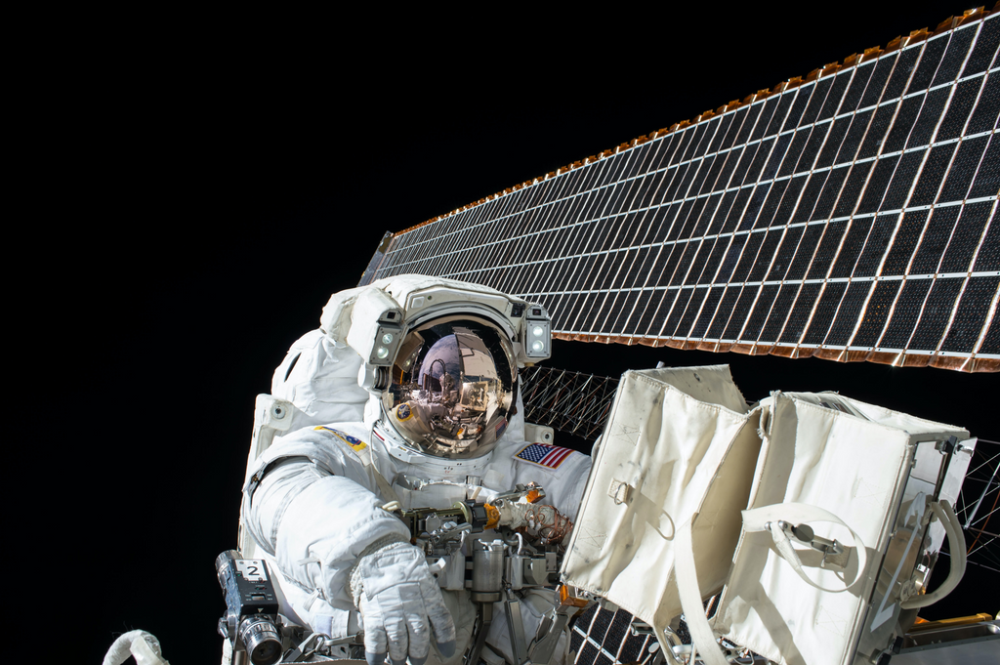
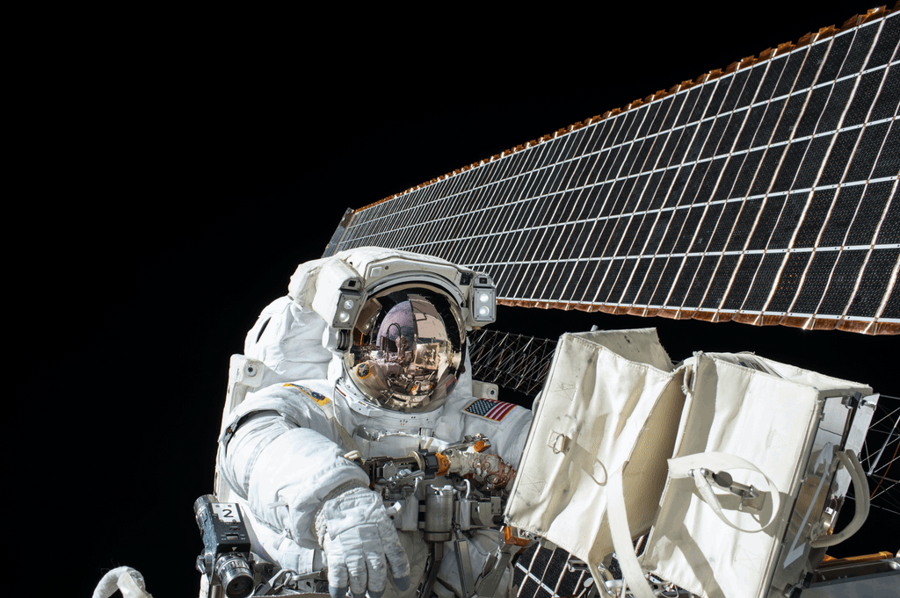

## The Image Trilemma

When optimizing images for websites, developers face a strict trilemma: you must balance Resolution, Bandwidth, and Loading Speed. It is practically impossible to achieve all three simultaneously without making a trade-off.

**High Resolution** + **Fast Loading**: Requires serving large, uncompressed file sizes. This significantly drives up your server bandwidth costs and relies heavily on the user having a fast internet connection to perform well.

**High Resolution** + **Low Bandwidth**: Requires heavy, complex image compression (WebP, AVIF, etc.). While the file size is small and cheap to host, the intense decoding process bottlenecks the browser's CPU, resulting in slower actual rendering speeds.

**Low Bandwidth** + **Fast Loading**: Requires sacrificing image quality entirely. The image will load instantly and cost very little to host, but it will look blurry or pixelated, especially on large screens or when zoomed in.

## What Oxim does?

Oxim provides flexible image compression, allowing you to choose between lossy and lossless modes based on your specific requirements. If you prioritize high resolution and fast rendering, Oxim’s lossless compression reduces file size while guaranteeing pixel-perfect accuracy.

Here is a comparison of a PNG image before and after lossless compression:

<Tabs>
  <Tab title="Before (1192 KB)">
    
  </Tab>
  <Tab title="After (872.6 KB)">
    
  </Tab>
</Tabs>

If bandwidth is your primary concern, you can apply lossy compression (for example, configuring `maxQuality: 80`) to achieve significant file size reductions:

<Tabs>
  <Tab title="Before (1192 KB)">
    
  </Tab>
  <Tab title="After (264.8 KB)">
    
  </Tab>
</Tabs>

## Oxim workflow

<Steps>
  <Step title="Bundler run">
    Oxim hooks into the bundling step, after bundler has produced the output assets (JS, CSS, SVG,
    images and so on).
  </Step>
  <Step title="Collect supported images">
    The plugin goes through every emitted asset and keeps only the ones with a supported format.
    Anything else, such as `app.js`, `style.css` or` icon.svg`, is skipped and left untouched.
  </Step>
  <Step title="Compress with napi-rs/image">
    Each matched image's buffer is passed to `napi-rs/image`. It runs in native Rust code and
    returns a new, smaller buffer. This is where your lossy mode (with the quality setting) or
    lossless mode applies.
  </Step>
  <Step title="Replace the old buffer">
    The original buffer in the bundle is swapped for the compressed one under the same file name, so
    references in your code and HTML don't change. The bundle then ships with the smaller images.
  </Step>
</Steps>
